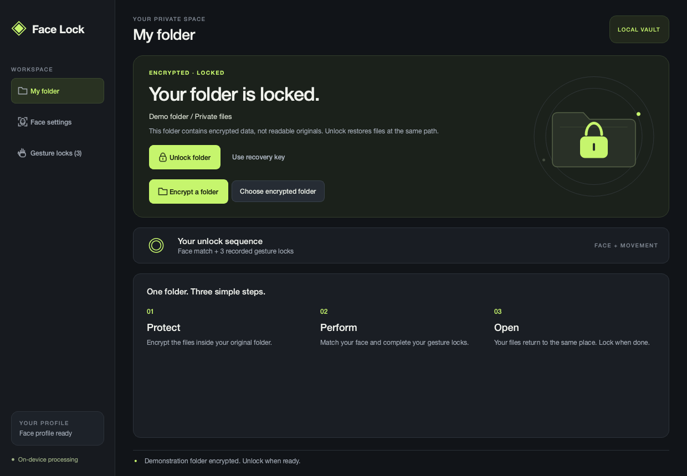
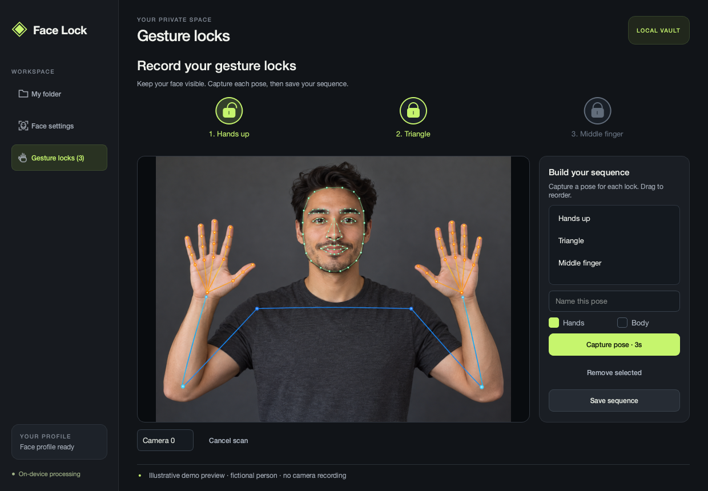
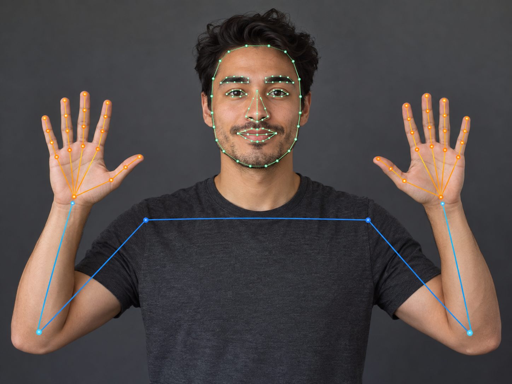

# Face Lock

A local macOS experiment: unlock an encrypted folder with your face and a sequence of hand or body poses you record yourself.

The folder stays at its original path. Locking replaces its readable contents with an encrypted archive inside that folder; unlocking restores the files there. There is no mounted volume, and the result is more than a folder fingerprint: file contents and filenames are encrypted.

**This is a playful prototype, not a trusted biometric security boundary.** The camera checks run in software and the app can retrieve its key from macOS Keychain. Someone controlling the logged-in Mac or modifying the app may bypass those checks. See [Security](SECURITY.md) before using it with valuable data.



*The actual folder workspace, shown with dummy data.*

## What it does

- Enrolls a face locally using OpenCV SFace, with MediaPipe landmarks drawn over the camera preview.
- Records 1–12 named hand/body poses and checks them in your chosen order.
- Shows a lock opening for each completed step while requiring the enrolled face to remain visible.
- Encrypts file contents and the filename/directory manifest with AES-256-GCM.
- Verifies the encrypted result before replacing readable originals.
- Restores normal files for Finder and editors, then includes changes when you lock again.
- Provides a recovery key when the camera or face recognition is unavailable.

Camera frames are processed in memory. The app does not save camera video or send it to a service. Face and gesture templates are encrypted locally; setup downloads dependencies and model assets.

## Setup

The supported development target is **macOS on Apple silicon, with Python 3.12**. A webcam and camera permission are needed for enrollment and normal unlocking. Other platforms and Python versions are not supported by this prototype.

From the repository root:

```sh
python3.12 -m venv .venv
source .venv/bin/activate
python -m pip install --upgrade pip
python -m pip install -r requirements.txt
python scripts/download_models.py
python main.py --check-models
python main.py
```

The downloader retrieves five model assets from their recorded upstream URLs and checks the SHA-256 digests in `models/models.json`. Keep that manifest in the checkout; it pins the assets used by the application. Models are downloaded locally rather than committed as binaries.

You can also run `Launch.command` after creating `.venv` and downloading the models. Allow camera access when macOS prompts. If access was previously denied, check **System Settings → Privacy & Security → Camera** for the app or launcher you use.

## Protect and open a folder

Try this with a small folder of disposable files first, and keep an independent backup.

1. Open **Set up my face**. Keep your face visible and follow the enrollment prompts.
2. Select **Encrypt a folder** and choose a specific data folder. Avoid application bundles, system folders, or a whole home directory.
3. Save the displayed `FL1-…` recovery key privately, outside the folder. It grants full access to the encrypted data.
4. Confirm **Encrypt original folder**. The app verifies the encrypted files before replacing the folder contents at the same path.
5. Select **Unlock folder** and follow the camera prompts. Without a custom sequence, the app asks for a blink and a head turn.
6. Select **Open in Finder** to work with the restored files.
7. Close editors using those files, then select **Lock folder**. Edits, additions, deletions, and empty directories are included in the new encrypted result.

Closing the app also attempts to lock an open folder. Switching to Finder does not lock it, so you can work with the files. Forced termination, a crash, or a power failure while unlocked can leave them readable. Check the folder state rather than assuming that quitting always finished encryption.

The managed folder contains a hidden `.face-lock-vault` directory. **Do not delete it, even while the folder is unlocked.** It holds the encrypted archive and folder state. A legacy standalone `.facevault` archive is an encrypted copy; it does not protect readable originals beside it. Use **Encrypt a folder** on the original folder for the current workflow.

## Make your own gesture locks



*The actual gesture workspace with a demonstration sequence and an illustrative synthetic camera frame. No live camera or successful authentication is shown.*

Open **Gesture locks** while the folder is locked:

1. Give the next pose a name and choose **Hands**, **Body**, or both.
2. Select **Capture pose · 3s**, then hold the pose after the countdown. Keep your face and the selected landmarks visible.
3. Repeat for each lock, drag steps to reorder them, and select **Save sequence**.

For example:

| Step | Pose to record | Useful capture option |
| --- | --- | --- |
| 1 | Both hands raised | Body, optionally Hands |
| 2 | A triangle formed with both hands | Hands |
| 3 | A raised middle finger | Hands |

During unlocking, hold the first pose until its lock opens, release it, then perform the next. Face loss resets progress. Each capture stores a landmark pose template, not a video clip or a named gesture classifier. The labels are yours: naming a step “Triangle” does not teach the app that gesture independently of your recording.

These are **held poses**, not arbitrary moving choreography. Camera angle, framing, lighting, handedness, and finger visibility affect matching. Record and test the sequence in the position where you expect to use it; live recognition needs calibration with your own poses.



*Illustrative synthetic example featuring a fictional adult. This is not a live application screenshot or an authentication result; it shows the idea of a landmark overlay.*

## Recovery and practical limits

Choose **Choose encrypted folder**, then **Use recovery key** and enter the saved key locally. Do not paste recovery keys into issues, screenshots, commits, or chat. The recovery key is equivalent to the vault encryption key; losing both it and the Keychain key can make the files unrecoverable.

The current limits are 64 MiB per file, 2 GiB total file data, 2,000 files, and 2,000 directories. Nested folders, Unicode names, and empty directories are supported. Symlinks and special files are rejected. Files with resource forks are rejected before replacing originals. Extended attributes, ACLs, original timestamps, and original permissions are not preserved.

Folder swaps use temporary sibling directories and need additional free disk space. Do not edit the folder during encryption or decryption. Successful cleanup removes readable originals, but it cannot guarantee erasure from SSD storage, backups, sync history, open file handles, or copies you exported elsewhere. A crash or failed cleanup may leave staging or original directories behind. [SECURITY.md](SECURITY.md) explains the protection boundary.

## How it is built

| Component | Responsibility |
| --- | --- |
| `facelock/ui.py`, `layout.py`, `visuals.py`, `lock_strip.py` | PySide6 interface, camera workspace, and progress display |
| `facelock/vision.py` | OpenCV face recognition and MediaPipe face, hand, and body landmarks |
| `facelock/gestures.py`, `gate.py` | Pose matching, ordered steps, and default movement challenge |
| `facelock/vault.py` | Authenticated file encryption, encrypted manifest, validation, and recovery keys |
| `facelock/folder_vault.py` | Verified staging, same-path folder swaps, and rollback on handled failures |
| `facelock/storage.py` | macOS Keychain access and encrypted local profile storage |
| `models/models.json` | Upstream asset URLs and pinned hashes |

Runtime profile and settings data are stored under `~/Library/Application Support/Face Lock/`. Secrets are stored through native Keychain APIs, not plaintext project configuration. Settings include the selected folder path; keep runtime data out of source control.

## Development and checks

With the virtual environment activated:

```sh
python -m pip install -r requirements-dev.txt
python -m pytest -q
QT_QPA_PLATFORM=offscreen python main.py --smoke-test --screenshot work/ui.png
python main.py --check-models
```

The smoke test renders the interface without opening the camera or reading Keychain. The model check loads the assets and runs blank-frame inference. Automated tests cover encryption and tamper rejection, recovery, encrypted templates, gesture ordering and face loss, folder swaps, and failure rollback. These checks do not establish live-camera recognition accuracy or resistance to spoofing.

To build the Apple silicon application bundle:

```sh
PYINSTALLER_CONFIG_DIR=work/pyinstaller MPLCONFIGDIR=work/mpl \
  python -m PyInstaller --noconfirm --distpath /private/tmp/face-lock-build FaceLock.spec
```

The bundle is created at `/private/tmp/face-lock-build/Face Lock.app`. This local build is not notarized or Developer ID signed. Review macOS distribution requirements separately before distributing a release. Model assets must be downloaded before packaging; upstream model license notices are included in `models/`.

## License

Application source is released under the [MIT license](LICENSE). Dependencies and model assets retain their own terms; see [third-party components](THIRD_PARTY.md).
